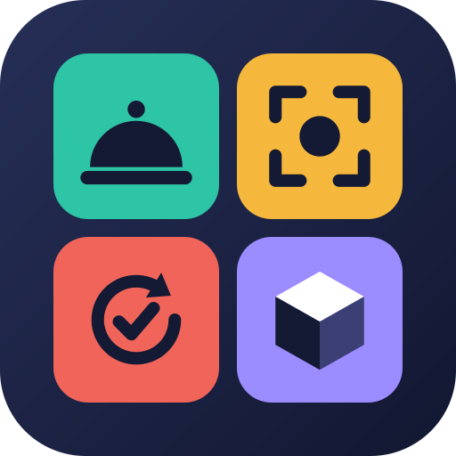

<p align="center">
  
</p>

<h1 align="center">agent-skills</h1>

<p align="center">
  <em>Four skills for coding agents: tidy the repo, test like a human, gate on a score, review the pixels.</em>
</p>

<p align="center">
  
  
  
  
</p>

---

They are written for Claude Code and follow the [Agent Skills](https://agentskills.io) format, so any other agent that reads `SKILL.md` can use them too.

## Install

Claude Code:

```
/plugin marketplace add XyndoX/agent-skills
/plugin install agent-skills@agent-skills
```

Any agent: `npx skills add XyndoX/agent-skills`, or copy a folder from `skills/` into your agent's skills directory (for Claude Code, `~/.claude/skills/`).

## Skills

| Skill | What it does |
|---|---|
| [roomservice](skills/roomservice/SKILL.md) | Cleans up a repo so humans and agents find things instantly. It sorts files, deletes dead ones and splits files over ~700 lines. It also writes a `MAP.md` that tells an agent where each kind of change goes. A chaos score and a navigation benchmark show the before and after. Every move is proposed first. |
| [snapshot](skills/snapshot/SKILL.md) | Takes one slice of the software (a feature, flow, screen, endpoint or CLI command) and tests it the way real people would use it. Those scenarios become golden snapshots. |
| [judge-loop](skills/judge-loop/SKILL.md) | A quality gate in scored rounds. An independent judge, never the author, scores the work 1–10 against a frozen rubric, with evidence for every number. The work is revised until it clears the bar (default ≥ 8 in 3 rounds). |
| [voxel-artist-loop](skills/voxel-artist-loop/SKILL.md) | How to commission visual art (voxel characters, scenes, rendered 3D) from an agent when tests can pass while the art looks wrong. Reference image first, look-and-iterate rounds, and the orchestrator reviews the pixels. |

## Use

Ask in plain words, for example "roomservice this repo", "snapshot the checkout flow", "judge this in 3 rounds" or "commission the wolf model". You can also run `/roomservice` and the others directly.

roomservice's survey script needs Python 3: `skills/roomservice/scripts/survey.py`, tested by `test_survey.py`.

## License

[MIT](LICENSE)
